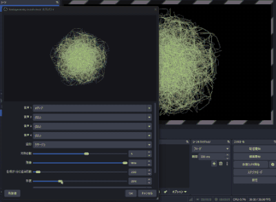

# オーディオアンビジオメトリ / Audio Ambigeometry

OBS Studio 向けの、音に合わせて意味のない幾何学図形がふわふわと漂う入力ソースのプラグインです。名前は ambient (環境の) と ambiguous (あいまいな) と geometry (幾何学) を合わせた造語です。

An input source plugin for OBS Studio that draws meaningless geometric shapes drifting softly with the sound. The name is a coined word from ambient, ambiguous, and geometry.

[配信プラグイン倉庫くん](https://soko-kun.allegromoltov.jp/plugins/allegromoltov/audio-ambigeometry) にも掲載しています。 / Also listed on [Plugin Soko-kun](https://soko-kun.allegromoltov.jp/plugins/allegromoltov/audio-ambigeometry?lang=en).



## Features / 機能

OBS Studio の音声ソースや最終ミックスの音を受け取り、その音に合わせて線で描いた図形を動かす入力ソースです。音が大きいほど図形は大きく明るくなり、低音・中音・高音の変化で図形が揺れたり回ったりします。色相は時間とともにゆっくり巡ります。音が止まると図形は小さく薄くなり、やがて透明になります。背景は透明なので、ほかの映像の上に重ねられます。

処理の軽さを優先しています。音の解析は 1 フレームに 1 回だけ行い、1 フレームに描く頂点は 2,048 個以下です。このプラグインはネットワークに何も送りません。

An input source that receives sound from OBS Studio audio sources or the final mix and moves line-drawn shapes with it. Louder sound makes the shapes larger and brighter, and changes in the bass, mid, and treble make them sway and turn. The hue cycles slowly over time. When the sound stops, the shapes shrink, fade, and become transparent. The background is transparent, so you can layer the shapes over other video. The plugin favors low processing cost: it analyzes the sound once per frame and draws at most 2,048 vertices per frame. The plugin sends nothing over the network.

- **Audio 1-4・音声 1〜4** - 反応させる音。OBS の音声ソースか、最終ミックス (トラック 1) を 4 つまで選べる
- **Pattern・図形** - 漂う多角形、波の輪、リサージュの 3 つから選ぶ
- **Symmetry・対称の数** - 図形を中心のまわりに等角で複製する数
- **Trail・残像** - 前のフレームの図形を薄めて残す量
- **Hue cycles per minute・色相が1分に巡る回数** と **Saturation・彩度** - 色の変わり方

## Installation / インストール

### Windows

Windows 版は OBS Studio 31.1 以降向けにビルドしています。OBS Studio 33.0.3 で、導入、音への反応、ミュート、音声ソースの名前の変更への追従、再起動後の設定の保持を確認しています。

#### 通常版 OBS への導入

プラグインを OBS Studio の共通プラグインフォルダーへ配置します。

1. OBS Studio を終了してください。
2. [Releases](../../releases) から Windows 用の zip ファイルをダウンロードし、展開してください。
3. エクスプローラーのアドレスバーへ `%PROGRAMDATA%` を入力し、Enter キーを押してください。隠しフォルダーの表示設定を変更する必要はありません。
4. `obs-studio` フォルダーを開き、その中の `plugins` フォルダーを開いてください。存在しないフォルダーは順に作成してください。
5. 展開した `audio-ambigeometry` フォルダーを `plugins` へコピーしてください。管理者の許可を求められた場合は許可してください。
6. OBS Studio を起動し、ソースの「+」からオーディオアンビジオメトリを追加してください。

導入後の構成を次に示します。`audio-ambigeometry` フォルダーを二重に作らないでください。PDB ファイルが同梱されている場合も、製品フォルダーごとコピーします。

```text
%PROGRAMDATA%\obs-studio\plugins\
└─ audio-ambigeometry\
   ├─ audio-ambigeometry.dll
   └─ data\
      ├─ ambigeometry.effect
      ├─ licenses\
      │  └─ milkdrop-fft.txt
      └─ locale\
         ├─ en-US.ini
         └─ ja-JP.ini
```

更新するときは、OBS Studio を終了し、同じ手順で `audio-ambigeometry` フォルダーを上書きコピーしてください。設定やシーンは削除しないでください。

#### ポータブル版 OBS

ポータブル版では、OBS Studio のルートフォルダーにある `plugins` へ製品フォルダーをコピーします。通常版の `%PROGRAMDATA%` への導入では読み込まれません。

OBS Studio を終了し、`bin` や `data` と同じ階層に `plugins` フォルダーを作成してください。展開した製品フォルダーをコピーし、`plugins\audio-ambigeometry\audio-ambigeometry.dll` と `plugins\audio-ambigeometry\data` を配置してから OBS Studio を起動します。

### Linux

Ubuntu では、Releases の `audio-ambigeometry-<version>-x86_64-linux-gnu.deb` を `sudo apt install ./<ファイル名>` で導入します。この .deb は、OBS Studio の公式の PPA (`ppa:obsproject/obs-studio`) から apt で導入した OBS Studio を前提にしています。

On Ubuntu, install `audio-ambigeometry-<version>-x86_64-linux-gnu.deb` from Releases with `sudo apt install ./<file name>`. The package expects OBS Studio installed with apt from the official PPA (`ppa:obsproject/obs-studio`).

GitHub Actions 上の Ubuntu 24.04 (Mesa の OpenGL) で、音に反応した図形の描画を自動で検証しています。作者は Linux の実機を持たないため、実機の GPU と OBS Studio では動作を確認していません。

### macOS

macOS 向けのビルドは GitHub Actions で生成していますが、作者は macOS 版を提供していません。ソースからのビルドは「Build / ビルド」を参照してください。

## Usage / 使い方

1. OBS Studio を起動
2. ソースの **+** ボタン → **Audio Ambigeometry** (または **オーディオアンビジオメトリ**) を追加
3. プロパティの **音声 1** で、反応させる音声ソース (デスクトップ音声、BGM のメディアソースなど) か **最終ミックス (トラック 1)** を選ぶ
4. 図形・対称の数・残像・色を調整する

声には反応させず BGM だけに反応させたいときは、BGM の音声ソースだけを選んでください。複数の音声ソースを選ぶと、それぞれの音を足し合わせた音に反応します。

To react only to background music and not to your voice, select only the music source. When you select several sources, the shapes react to the sum of their sound.

## Parameters / パラメータ

| Parameter | 日本語 | Range | Default |
|-----------|--------|-------|---------|
| Audio 1-4 | 音声 1〜4 | (None) / Final mix (Track 1) / audio sources | (None) |
| Pattern | 図形 | Drifting polygons / Wave ring / Lissajous | Drifting polygons |
| Number of shapes | 図形の数 | 1 ~ 12 | 6 |
| Symmetry | 対称の数 | 1 ~ 8 | 1 |
| Trail | 残像 | 0% ~ 98% | 90% |
| Hue cycles per minute | 色相が1分に巡る回数 | 0 ~ 60 | 6 |
| Saturation | 彩度 | 0% ~ 100% | 80% |
| Width / Height | 幅・高さ | 16 ~ 4096 | 1280 / 720 |

図形の数は、漂う多角形を選んだときだけ表示されます。リサージュは左右の音の波形を横と縦にした図形で、左右が同じ音では、少し遅らせた音を縦に使います。残像を 0% にすると、前のフレームを残す処理そのものを行いません。

Number of shapes appears only for Drifting polygons. Lissajous plots the left and right waveforms on the horizontal and vertical axes; for sound with identical channels, it uses a slightly delayed copy for the vertical axis. A trail of 0% skips the trail processing entirely.

## Known Behavior / 既知の挙動

- 音声ソースの音は、OBS のミキサーの音量 (フェーダー) を掛けてから使います。ミュートした音声ソースには反応しません。最終ミックスは、ミキサーの音量とミュートを反映した後の音です。
- 最終ミックスは、配信の既定の音声トラックであるトラック 1 を使います。
- 選んだ音声ソースの名前を変えると、設定も新しい名前に追従します。選んだ音声ソースを削除すると、その欄は無音として扱われます。同じ名前のソースを作り直すと、1 秒ほどで再び反応します。
- 残像は、このソースが画面に描かれるたびに進みます。どのシーンにも表示されていない間は残像が止まり、再び表示されたときに残っていた残像から薄れていきます。
- 線の太さは 1 画素です。

## Build / ビルド

### Requirements / 必要環境

| Platform | Tool |
|----------|------|
| Windows | Visual Studio 17 2022 |
| Windows | CMake 3.28+ |
| macOS | Xcode 16.0, CMake 3.28+ |
| Ubuntu 24.04 | ninja-build, pkg-config, build-essential, CMake 3.28+ |

### Build Commands / ビルドコマンド

```bash
# Windows
cmake --preset windows-x64
cmake --build build_x64 --config RelWithDebInfo

# macOS
cmake --preset macos
cmake --build build_macos --config RelWithDebInfo

# Ubuntu
cmake --preset ubuntu-x86_64
cmake --build build_x86_64 --config RelWithDebInfo
```

Windows で生成物を取り出すには、`cmake --install build_x64 --config RelWithDebInfo --prefix release/RelWithDebInfo` を実行してください。生成した製品フォルダーを前述の手順で導入してください。

Windows では、音の解析のユニットテストと、描画テストを Direct3D 11 と OpenGL の両方で CTest に登録しています。OBS のグラフィックスの DLL を `cmake --build .deps/obs-studio-31.1.1/build_x64 --config Release --target libobs-d3d11 libobs-opengl` で作ってから、`ctest --test-dir build_x64 -C RelWithDebInfo` を実行してください。

## Third-Party Code / 第三者のコード

`src/milkdrop-fft.hpp` と `src/milkdrop-fft.cpp` は、[projectM](https://github.com/projectM-visualizer/projectm) の `MilkdropFFT` を写したもので、Nullsoft, Inc. の BSD 3 条項のライセンスにしたがいます。ライセンスの全文は `data/licenses/milkdrop-fft.txt` にあります。低音・中音・高音の求め方は、[Butterchurn](https://github.com/jberg/butterchurn) の `audioLevels.js` と同じ計算です。

`src/milkdrop-fft.hpp` and `src/milkdrop-fft.cpp` are adapted from `MilkdropFFT` of projectM and follow the BSD 3-Clause license of Nullsoft, Inc. The full text is in `data/licenses/milkdrop-fft.txt`. The bass, mid, and treble levels use the same calculation as `audioLevels.js` of Butterchurn.

## AI利用開示 / AI Disclosure

### 日本語

v1.0.0 の制作では、Anthropic Claude Code を、調査、ソースコード、ビルド設定、テスト、文書を含むほぼすべての工程で使用しました。リソースアイコンは、Claude Code が作成した SVG の案から、作者本人が選びました。

作者本人は Windows 上の OBS Studio でユーザーテストを実施しました。コード読解による厳密な人間レビューは実施していません。概要説明欄のアニメーション GIF は、作者本人が ScreenToGif で画面収録したもので、生成 AI を使用していません。容量を収めるための縮小は、Claude Code が ffmpeg で行いました。

### English

Anthropic Claude Code was used for almost the entire development process of v1.0.0, including research, source code, build configuration, tests, and documentation. The resource icon was chosen by the author from SVG candidates that Claude Code drew.

The author performed user testing in OBS Studio on Windows but did not perform a rigorous human review of the source code. The animated GIF in the description was screen-recorded by the author using ScreenToGif, without generative AI. Claude Code reduced its file size with ffmpeg.

## License / ライセンス

GPL-2.0 License (GPL-2.0-or-later)

このプラグインは [obs-plugintemplate](https://github.com/obsproject/obs-plugintemplate) をベースにしています。

## Author / 作者

AllegroMoltoV - https://www.allegromoltov.jp

## Changelog / 更新情報

### v1.0.0

- 最初の公開版です。
